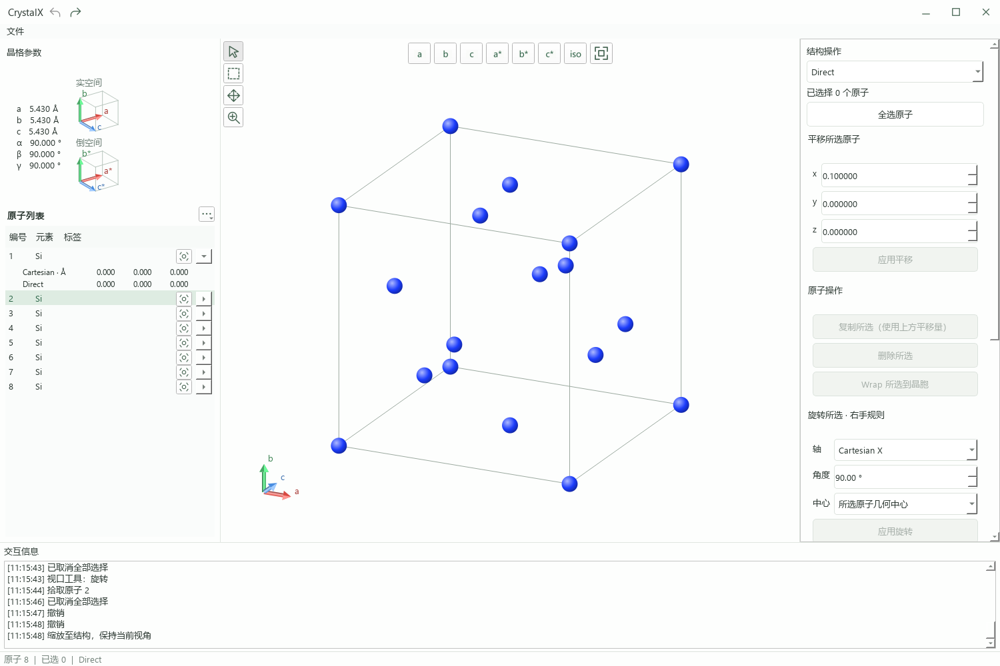

# CrystalX

A Python/PyQt6 desktop application for crystal structure visualization, interactive editing, and VASP POSCAR file generation.

CrystalX 是一款基于 Python 与 PyQt6 的晶体结构可视化与编辑软件，支持 VASP 结构文件读写、周期边界显示、原子选择、几何变换、超胞构建及撤销／重做，采用简洁的浅色桌面界面。

**状态：早期开发版本（Early Development），当前版本 0.9.2。**



## 功能

- VASP 5 POSCAR / CONTCAR / `.vasp` 读写，支持 Direct / Cartesian、单一正缩放因子或负目标体积。
- 保留 Selective dynamics 标志与原子标签；保存时按元素分组。
- 晶胞与原子轻量投影显示，自动周期边界映射及边界镜像，镜像选择映射回源原子。
- 直接／倒易基矢视角、等轴测、旋转、平移和缩放。
- 点选、框选、Ctrl 叠加，以及任意工具下双击原子选择。
- 平移、复制、删除、旋转、wrap、对角超胞和 T/F 弛豫标志编辑。
- 撤销／重做、未保存提示、覆盖确认和临时文件替换保存。
- 实／倒空间晶胞示意、双参考系坐标窗口与交互消息区。

## 安装与启动（Windows）

需要 Python 3.10+；当前主要在 Windows 上验证。

```powershell
git clone https://github.com/alwaysthis/CrystalX.git
cd CrystalX
python -m venv .venv
.\.venv\Scripts\python.exe -m pip install -e .
```

双击 `launch.vbs` 使用虚拟环境中的 `pythonw.exe` 启动，不弹出终端。启动失败时检查 `logs/crystalx.log`。开发调试可运行：

```powershell
.\.venv\Scripts\python.exe -m crystalx
```

从“文件 → 打开”载入结构，或先打开 `examples/Si.vasp` 体验。

## 使用

左侧连续显示晶格参数与原子列表。点击列表行仅查看信息；倒数第二列选择按钮用于结构选择，最右侧展开双坐标，数值保留三位小数。三点菜单打开坐标窗口，切换参考系保留滚动位置与选择，显示九位小数。

默认箭头工具拖动旋转，第二工具支持点选／框选；选择默认替换，Ctrl 叠加。任意工具下双击可选择单原子，单击画布清空选择。顶部平铺 a/b/c、a*/b*/c* 和等轴测视角；最后一个按钮重置方向、缩放和平移。

右侧执行结构操作。平移与复制位移单位随坐标模式切换；旋转始终绕笛卡尔 X/Y/Z 轴，遵循右手规则，中心可选原点或所选原子几何中心。超胞作用于整个结构，界面生成上限为 10000 原子。原子数量变化及撤销／重做后清空选择。

周期显示不修改原始坐标或导出数据。倒易基矢不包含 2π，实／倒空间预览分别归一化显示。

## 当前范围

暂不支持 CIF、VASP 4 无元素名文件、三个缩放因子、速度及其他尾部区段；遇到不支持的文件区段会报错。当前没有化学键、镜像编辑、真空层／薄膜操作及 INCAR/KPOINTS/POTCAR 输入集生成。视口采用 QPainter 轻量投影，并非完整科学渲染后端。

## 配置与项目结构

- `src/crystalx/`：应用、独立结构模型、读写与编辑命令。
- `config/default/`：版本化默认配置；`config/custom/app.json` 按顶层键覆盖默认值。
- `.memory/`：设计原则、功能计划、经验教训。
- `logs/`：本地运行日志，不纳入版本控制。
- `examples/`、`tests/`、`scripts/`：示例及验证工具。

## 开发与验证

**Agent 编程前必须读取 `.memory/` 文件夹中的全部文档，进行学习并遵守设计原则与代码规范。** 修改完成后更新相关项目记忆与 `CHANGELOG.md`。

```powershell
.\.venv\Scripts\python.exe -m unittest discover -s tests
.\.venv\Scripts\python.exe scripts/check_ui.py
```

第二条命令执行离屏界面检查并在 `output/` 生成截图；其字体加载针对 Windows。

## 配色来源

元素色表来自 [OVITO 官方提供的 VESTA 主题](https://www.ovito.org/download/data/documentation/VESTA.ovito-theme)，未知元素使用灰色。PyQt6 及外部数据的使用应遵守各自许可条款。
