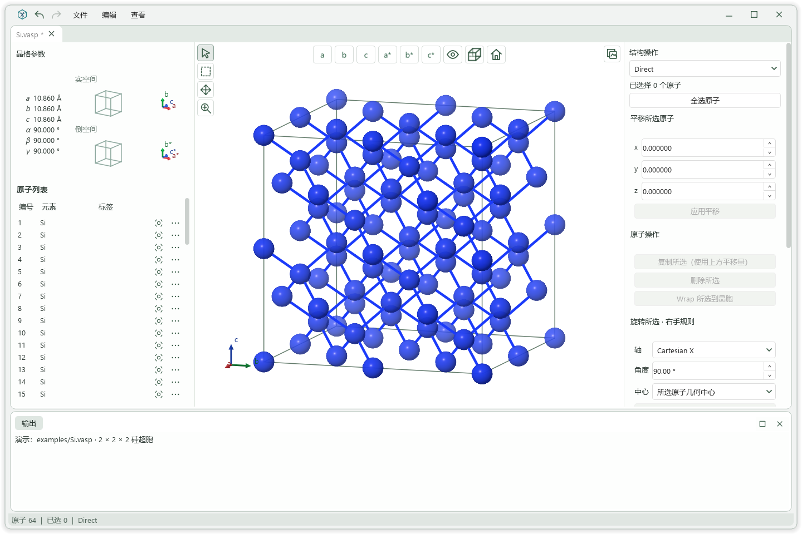
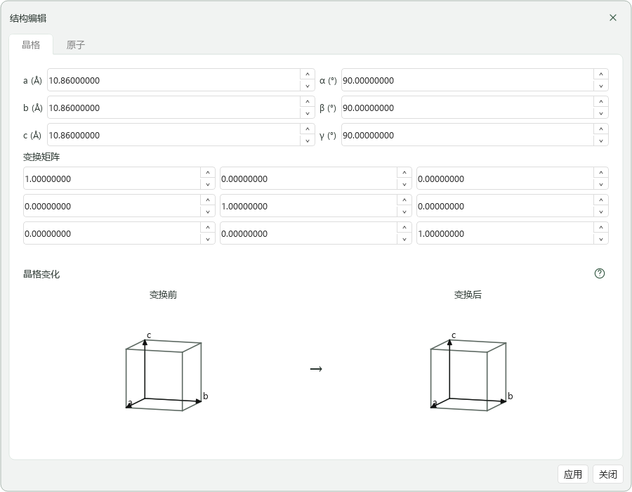
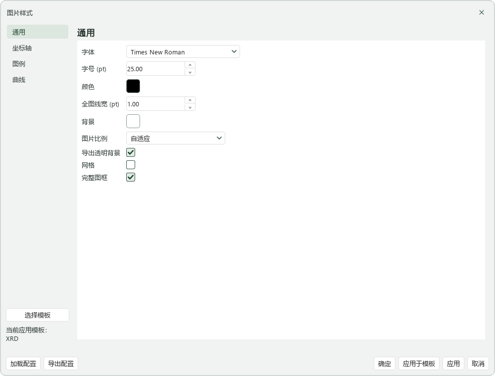
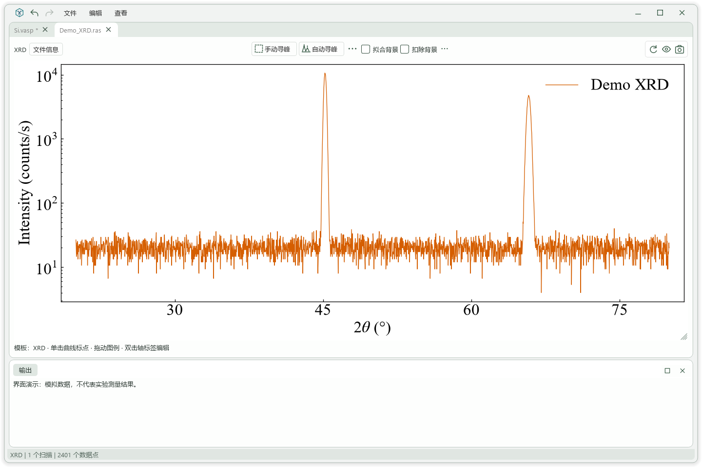
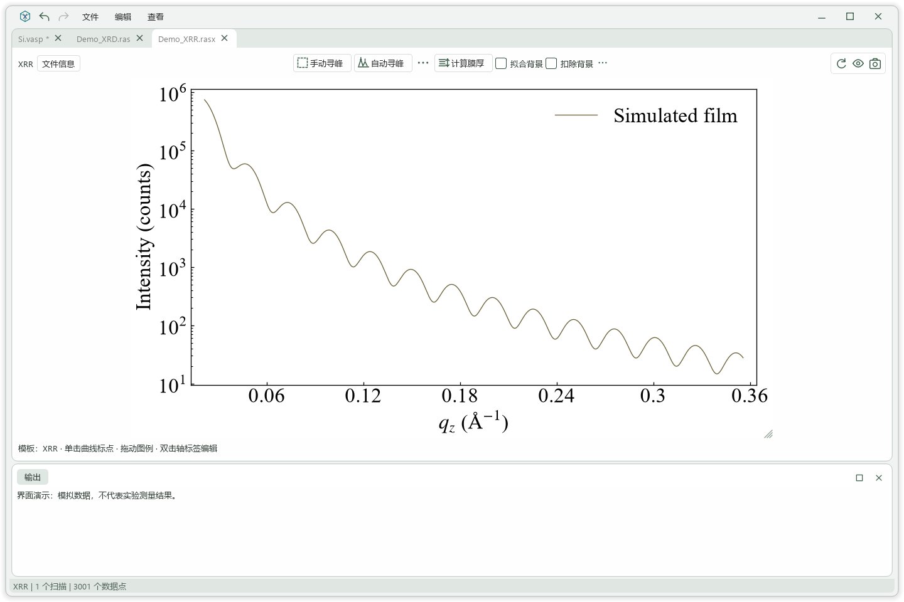
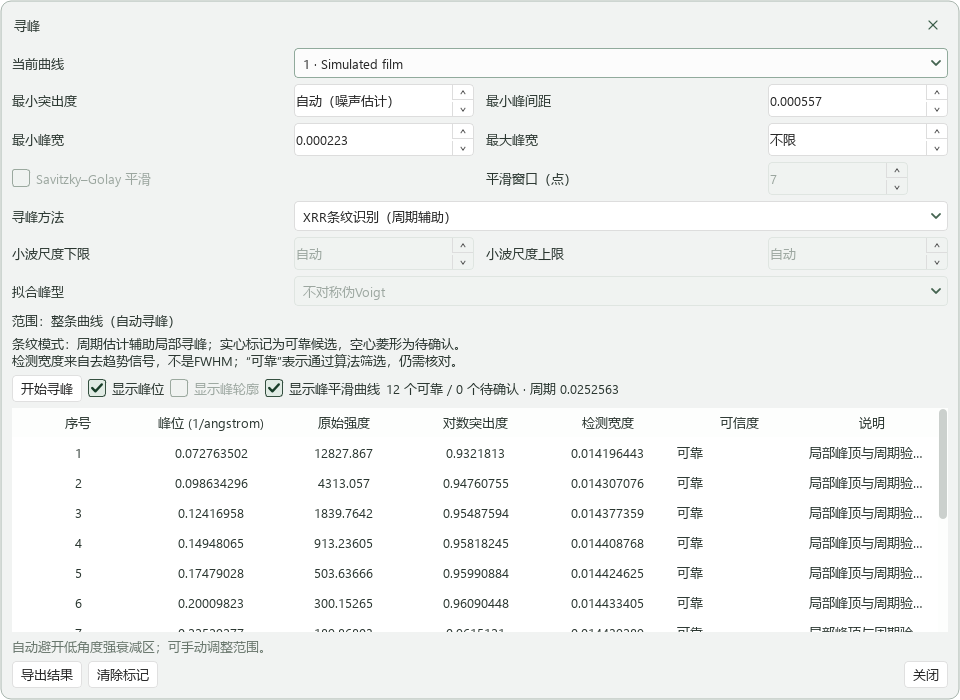
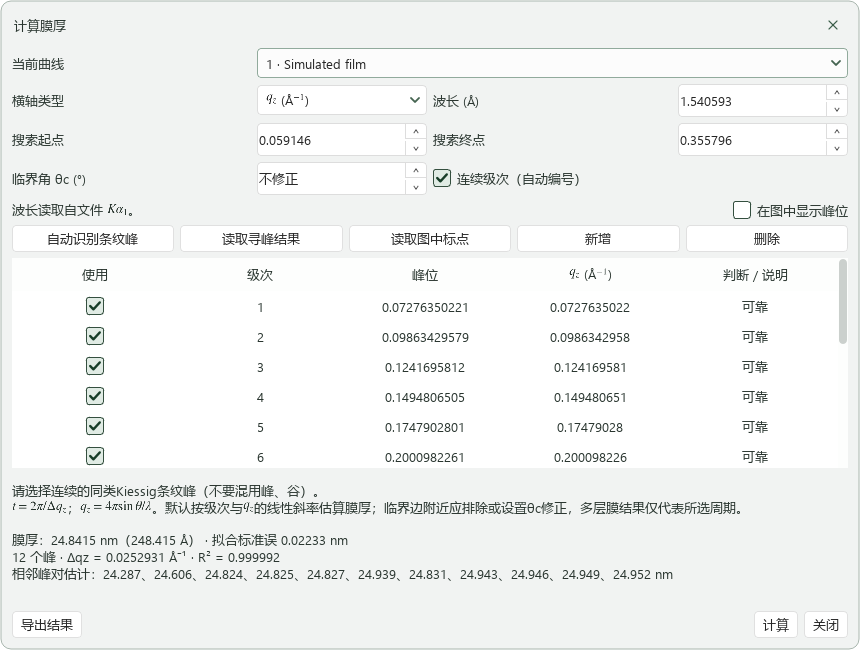
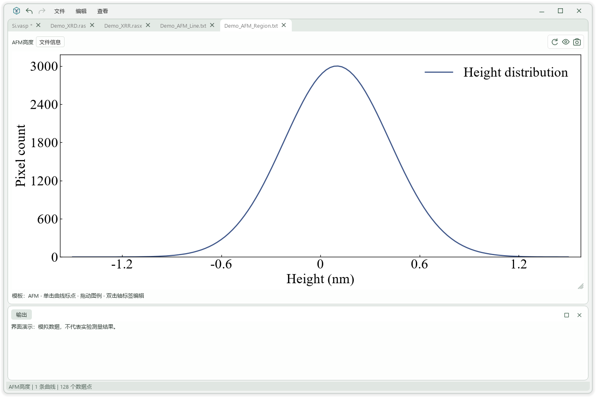
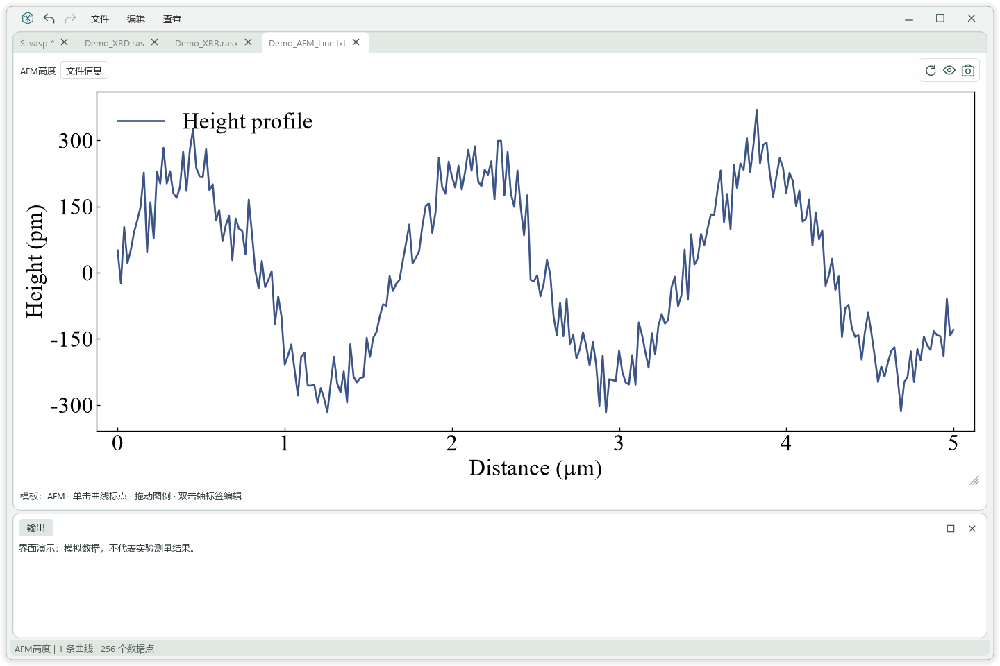

# CrystalX

> **Agent 必读：编程前必须完整阅读并学习 [`.memory/`](.memory/) 文件夹中的全部文档，遵守其中的设计原则与代码规范。完成修改后，必须更新相关项目记忆及 [`CHANGELOG.md`](CHANGELOG.md)；更新日志按从新到旧排列，最新记录放在顶部。**

CrystalX 是基于 Python / PyQt6 的材料结构与实验数据桌面工作台：可查看、编辑晶体结构并生成 VASP 文件，也可绘制和分析 XRD、XRR、Rocking Curve 及 AFM 高度数据。

**当前版本：0.37.1 · 持续开发中 · 主要在 Windows 上验证。**



*当前界面实拍：仓库中的 Si 示例构建为 2 × 2 × 2 超胞。下文实验数据界面均使用脚本生成的模拟数据，展示功能，不代表实验测量结果。*

## 功能导航

- [格式与文件管理](#格式与文件管理)：多文件打开、文件夹记忆、独立标签、可编辑绘图文件。
- [晶体结构](#晶体结构)：周期显示、自动成键、原子与晶格编辑、超胞、显示材质。
- [科学绘图](#科学绘图)：论文样式、四侧坐标轴、公式、图例、多曲线与模板。
- [XRD 与 Rocking Curve](#xrd-与-rocking-curve)：计数率换算、背景处理、寻峰与峰型拟合。
- [XRR 条纹与膜厚](#xrr-条纹与膜厚)：q_z 坐标、周期辅助识别、Kiessig 膜厚估算。
- [AFM 高度数据](#afm-高度数据)：高度分布、线剖面及统计信息。
- [安装与启动](#安装与启动windows)、[开发与项目约定](#开发与项目约定)。

## 格式与文件管理

| 数据类型 | 支持格式 | 主要用途 |
| --- | --- | --- |
| 晶体结构 | VASP 5 POSCAR、CONTCAR、`.vasp`、`.cif` | 结构查看、编辑；导出 POSCAR |
| 衍射 / 反射扫描 | `.ras`、`.rasx` | 读取扫描曲线与测量信息；支持含多扫描的文件 |
| 通用二维曲线 | `.xy`、`.dat`、`.txt`、`.csv` | 两列数值数据，可含受支持的注释或表头 |
| AFM 高度数据 | 带 X / Y 单位头的 `.txt` | 高度分布与线剖面，按内容识别 |
| 可编辑图片工程 | `.cxplot` | 保存原始数据、曲线、样式、分析状态与视图，之后继续编辑 |
| 绘图导出 | PNG、SVG、PDF、剪贴板 | 位图或可用 Inkscape 等工具编辑的矢量图 |

从“文件 → 打开”可一次选择多个文件；每个文档使用独立标签，标签可左右移动，也可以全部关闭。成功打开文件后，软件会记住所在文件夹，下次打开任意受支持格式时共用该位置。

下方终端显示简要输出，可调节高度、最大化或关闭，通过“查看 → 显示终端”重新显示。

**保存与导出用途不同：** 保存 `.cxplot` 会嵌入原始扫描、各条曲线数据、图例、样式、类型、分析标记和视图信息，重新打开不依赖原数据文件；导出 PNG / SVG / PDF 得到可用于论文或报告的图片。结构可通过“文件 → 导出为 → POSCAR”输出。

## 晶体结构

### 查看、选择与周期显示

- 左侧显示晶格参数、可旋转的实空间 / 倒空间晶胞及紧凑原子列表；原子信息包含编号、元素、标签和可展开的两套坐标。
- 中间支持旋转、平移、缩放、框选，以及沿 a、b、c 和倒易基矢观察；透视强度可调，重置视图会同时恢复朝向和缩放。
- 原子自动应用周期边界，边界镜像对应同一个源原子；双击可选择原子，Ctrl 可叠加选择。
- 原子列表行高亮用于查看信息，行内的选择按钮独立控制原子选择。
- 可切换方向轴、原子、晶胞、元素、编号、标签的可见性，并隐藏或删除选定原子。
- 自动成键采用参考 VESTA 的元素对键长范围；通过“编辑 → 键”增删或修改规则。

### 编辑晶格与原子

“编辑 → 结构”提供晶格和原子两个页面。晶格页面可直接修改 a、b、c、α、β、γ，也可以输入变换矩阵，并查看变换前后的晶胞预览。



- **修改晶格参数**：保持原子分数坐标，原子随晶胞一起变化。
- **应用变换矩阵**：保持原子笛卡尔位置；要求新基矢落在原晶格整数格点上，矩阵必须可逆。参数与矩阵同时修改时，先改参数，再应用矩阵。
- 原子页面可新增、删除原子，修改元素、坐标、标签与 Selective dynamics 标志；分数 / 笛卡尔坐标可切换。
- 右侧操作区提供平移、复制、旋转、删除、周期归一化和对角超胞构建。
- 结构修改支持撤销 / 重做与未保存提示。变换矩阵操作与复制原子的超胞构建是两个独立功能。

### 显示样式

显示区右键进入“显示样式”，分别设置晶格、原子和键，并选择作用于当前对象、当前结构或全局。

晶格可设置线型、圆柱、颜色、线宽和方向轴箭头；原子可设置元素默认色或自定义颜色、原子 / 离子 / 范德华半径及独立半径值、边框、渐淡与材质参数；键可调整线型、配色和粗细。样式支持加载、导出、恢复默认及设为全局默认。

## 科学绘图

### 论文样式与坐标轴

默认使用 **Times New Roman、25 pt、黑色文字、完整图框**。屏幕中图框内部为纯白，默认导出全图透明背景；这些选项都可修改。

图中右键进入“图片样式”，左侧按通用、坐标轴、图例、曲线分类，右侧编辑对应内容。在坐标轴或图例上右键进入时，会定位到相应页面。



| 设置区域 | 可定制内容 |
| --- | --- |
| 通用 | 字体、字号、颜色、全图线宽、背景、导出透明度、网格、图框与图片比例 |
| 坐标轴 | 四侧轴分别设置可见性、字体、颜色、线宽、刻度方向、刻度间距 / 数组、数值格式、标签与标签样式 |
| 刻度 | 线性、根号、经典疏密变化的对数刻度；普通数字、科学计数法与上标乘幂格式 |
| 图例 | 字体、字号、颜色、边框，以及哪些曲线进入图例 |
| 曲线 | 逐条设置线型、线宽、颜色、marker 形状与大小、填充色、边缘色和图例名称 |

刻度数组支持受限 MATLAB 风格的数值表达，例如 `[0:10:100]`；填写数组后，间距设置暂停生效。刻度标签支持文本数组，数字也可转为文本。

图片比例可选自适应、4:3、1:1、16:9 或自定义宽高比，也可拖动图片右下角手柄调整；双击手柄恢复自适应。比例与样式随 `.cxplot` 保存，导出沿用当前比例。

### 曲线、图例与公式

- 鼠标靠近曲线时显示对应点的响应，单击可标点；右键曲线会选择该曲线并提供操作菜单，Esc 可取消选择。
- 图例可拖动；双击图例文字或轴标签直接编辑内容。右键图例可配置显示条目，全部取消后仍保留可交互的占位入口，便于恢复。
- 支持复制、粘贴、删除曲线，Ctrl+C / Ctrl+V 可跨图操作；复制会携带曲线样式和图例名称，加入新图后仍可独立修改与分析。
- “新增曲线 → 文件”从数据文件添加曲线；“新增曲线 → 表达式”支持函数与隐式方程，例如 `x^2, {x, -1, 1}`、`Sin[t]`、`x=1`。表达式内的定义域优先于独立定义域输入。
- 图例、轴标签及受支持的界面文本在出现 `$...$` 或 `$$...$$` 时启用数学排版，可写希腊字母、上下标、`\rm`、`\bf`、`\mathscr` 等。
- 绘图的样式、曲线、可见性、分析标记和视图操作支持撤销 / 重做；单次连续拖动作为一次操作。

轴上滚轮只缩放对应轴；轴右键可快速设置刻度类型和最大 / 最小范围。图内右键的“导出图片”包含复制图片、保存位图及 SVG / PDF 矢量导出，导出不会包含工具栏、拖动手柄等界面控件。

### 模板与配置

依据文件内容自动选择 XRD、XRR、Rocking Curve、AFM 或 global 模板；AFM 高度分布与线剖面共用 AFM 模板。

图片样式左下角显示当前模板，可选择模板文件、加载或导出配置。“应用”只修改当前图，“应用于模板”更新对应模板，供之后打开的数据使用；显式设置的轴标签也可随模板保留。每条曲线既可继承通用样式，也可单独覆盖，继承颜色用灰色虚线色块表示。

## XRD 与 Rocking Curve



顶部居中工具栏提供手动寻峰、自动寻峰和背景处理；三点按钮打开完整分析窗口。手动寻峰先框选区间，自动寻峰直接分析当前曲线；多条曲线可以分别选择、分别处理。

- 寻峰方法包含突出度、导数、小波及模型拟合，可调整突出度、峰距、宽度、平滑等参数。
- 峰型拟合支持 Gaussian、Lorentzian、伪 Voigt 与不对称伪 Voigt；结果提供峰位、半高全宽（FWHM）等信息。
- 可选择显示峰位、峰轮廓、平滑曲线；拟合轮廓和平滑结果作为正常曲线，可改样式、显示图例、复制或删除。
- 背景支持拟合、显示与扣除，原始扫描保留；拟合和检测结果可导出 CSV。
- 文件信息展示扫描轴、单位、步长、速度等可读取参数及绘图单位换算依据。

**计数率：** 对明确记录为 counts、且具有有效步长与扫描速度的数据，按文件参数推算每步时间并换算为 `Intensity (counts/s)`；已是计数率的数据不会重复换算。缺少参数时保留原单位，并说明原因。此换算尚未与原厂软件的 cps 导出逐点比对，文件信息会保留推算依据。

## XRR 条纹与膜厚

### q_z 坐标与专用条纹识别



有有效波长时，将角度换算为 `q_z = 4π sin(θ) / λ`（Å⁻¹）；2θ 扫描先取一半角度。缺少波长时保留角度并提示，纵轴保留强度。

XRR 默认使用“周期辅助条纹识别”：估计主周期并检查自相关，再结合局部噪声、宽度和间距筛选，回查原曲线峰顶。顶部寻峰与膜厚窗口共用算法，可自动建议避开低角度强衰减区和高噪声尾部，也可手动指定范围。



结果区分可靠候选与待确认，并显示判断原因；待确认用空心菱形标记，默认不参与膜厚计算。“可靠”表示通过算法筛选，仍需核对实际曲线。条纹检测宽度不是 FWHM，专用条纹模式不把它当作拟合峰宽。

### 计算膜厚

“计算膜厚”可自动识别或手动输入峰位，勾选参与计算的条纹，并在漏峰时调整级次。支持角度和 q 输入、波长设置及可选临界角修正；图中峰位标记可开关。



通过条纹级次与 q 的线性关系估算平均周期，按 `t = 2π / Δq_z` 得到厚度；显示 nm / Å、拟合统计与相邻条纹估算，可导出结果。上图为约 25 nm 模拟单层数据的演示。

这属于 Kiessig 条纹膜厚估算，尚未实现完整的 Parratt / Abeles 多层反射率拟合。多周期、重叠结构、漏峰和低信噪比会影响结果，需结合候选状态与物理结构判断。

## AFM 高度数据

### 高度分布



读取带单位头的 Region 类文本，横轴是高度，纵轴是像素频数。文件信息提供加权均值、峰值、方差及 Ra / Rq 等估计。

### 线剖面



读取 X / Y 都是长度单位的 Line / Line_slanted 类文本，横轴为距离、纵轴为高度，保留负高度和 pm、nm、µm 等单位。文件信息显示高度采样点的均值、极值、峰谷差、方差及 Ra / Rq 估计；这些是剖面统计，不代表完整二维表面。

文件类型依据单位头与数据内容识别，不依赖文件名：长度 / pixels 识别为高度分布，长度 / 长度识别为线剖面。两者都使用 AFM 模板，也支持通用绘图的样式、图例、比例与导出功能。

## 安装与启动（Windows）

需要 Python 3.10+，建议使用独立虚拟环境：

```powershell
git clone https://github.com/alwaysthis/CrystalX.git
cd CrystalX
python -m venv .venv
.\.venv\Scripts\python.exe -m pip install -e .
```

双击 [`launch.vbs`](launch.vbs) 使用虚拟环境中的 `pythonw.exe` 启动，不弹出终端；可运行 [`create_shortcut.vbs`](create_shortcut.vbs) 创建带软件图标的快捷方式。开发调试可运行：

```powershell
.\.venv\Scripts\python.exe -m crystalx
```

首次体验可打开 [`examples/Si.vasp`](examples/Si.vasp)，或从“文件 → 打开”选择受支持的实验数据。

## 配置与项目目录

| 目录 / 文件 | 用途 |
| --- | --- |
| `.memory/` | 设计原则、功能计划、已验证实现与经验教训 |
| `config/default/` | 随仓库提供的默认配置及绘图模板 |
| `config/custom/` | 本机用户配置与自定义覆盖，不纳入版本控制 |
| `logs/` | 运行日志；排查错误优先查看 `crystalx.log`，原生崩溃记录见 `crash.log` |
| `src/crystalx/` | 结构模型、文件读写、绘图、分析与 Qt 界面 |
| `native/` | 可选 C++ 成键搜索与材质内核 |
| `examples/` | 可公开的示例结构 |
| `docs/screenshots/` | 当前界面截图 |
| `tests/`、`scripts/` | 单元测试、集成检查与辅助工具 |
| `CHANGELOG.md` | 从新到旧的版本变更记录 |

## 开发与项目约定

编程前阅读 [`.memory/README.md`](.memory/README.md) 及其目录中的全部文档。项目遵循高内聚、低耦合、不过度防御性编程；领域计算与 Qt 界面分离，默认配置与用户配置分离。

```powershell
# 单元测试
.\.venv\Scripts\python.exe -m unittest discover -s tests

# 重新生成本文截图：Si 示例 + 固定随机种子的模拟数据
.\.venv\Scripts\python.exe scripts/capture_readme.py
```

截图工具使用临时会话，不修改用户上次打开的文件夹；仓库文档不包含真实研究数据。成键搜索与材质生成可使用可选 C++ 内核，未编译时采用 Python 实现，普通安装不要求 C++ 编译器，见 [原生内核说明](docs/native-kernels.md)。

### 当前边界

- VASP 输入以 VASP 5 格式为主；不支持无元素名称的 VASP 4、三分量缩放及所有附加段。CIF 无序 / 部分占位结构尚有限制。
- RASX 当前读取压缩包中的一维 Profile 扫描，不覆盖所有厂商二进制或二维探测器图像。
- 晶体显示采用轻量投影与缓存材质；粗糙度、折射率、光泽是显示近似，不是 Blender 级物理渲染。
- 数学文字采用 Mathtext 支持的 LaTeX 子集，表达式输入采用受限的 Mathematica 风格数值语法；不等同于完整 LaTeX 引擎或 Mathematica。
- 拟合与膜厚结果用于辅助分析，低计数、重叠峰或多周期数据应人工复核。

界面样式参考 [x_rheed 的 studio 分支](https://github.com/zaxoniu/x_rheed/tree/studio)，晶体配色、半径及成键范围参考 VESTA。版本历史与各次验证记录见 [`CHANGELOG.md`](CHANGELOG.md)。
