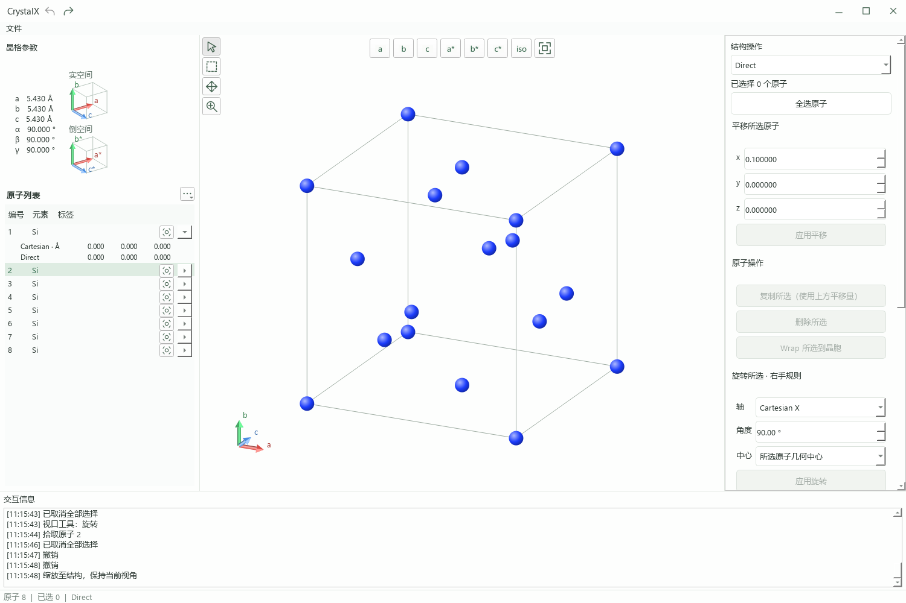

# CrystalX

A Python/PyQt6 desktop application for crystal structure visualization, interactive editing, and VASP POSCAR file generation.

CrystalX 是一款基于 Python 与 PyQt6 的晶体结构可视化与编辑软件，支持 VASP 结构文件读写、周期边界显示、原子选择、几何变换、超胞构建及撤销／重做，采用简洁的浅色桌面界面。

**状态：早期开发版本（Early Development），当前版本 0.10.0。**



## 功能

- VASP 5 POSCAR / CONTCAR / `.vasp` 读写，支持 Direct / Cartesian、单一正缩放因子或负目标体积。
- 保留 Selective dynamics 标志与原子标签；保存时按元素分组。
- 晶胞与原子轻量投影显示，自动周期边界映射及边界镜像，镜像选择映射回源原子。
- 直接／倒易基矢视角、等轴测、旋转、平移和缩放。
- 点选、框选、Ctrl 叠加，以及任意工具下双击原子选择。
- 平移、复制、删除、旋转、wrap、对角超胞和 T/F 弛豫标志编辑。
- 撤销／重做、未保存提示、覆盖确认和临时文件替换保存。
- 实／倒空间晶胞示意、双参考系坐标窗口与交互消息区。

## 安装与启动（Windows）

需要 Python 3.10+；当前主要在 Windows 上验证。

```powershell
git clone https://github.com/alwaysthis/CrystalX.git
cd CrystalX
python -m venv .venv
.\.venv\Scripts\python.exe -m pip install -e .
```

双击 `launch.vbs` 使用虚拟环境中的 `pythonw.exe` 启动，不弹出终端。启动失败时检查 `logs/crystalx.log`。开发调试可运行：

```powershell
.\.venv\Scripts\python.exe -m crystalx
```

从“文件 → 打开”载入结构，或先打开 `examples/Si.vasp` 体验。

## 使用

左侧连续显示晶格参数与原子列表。点击列表行仅查看信息；倒数第二列选择按钮用于结构选择，最右侧展开双坐标，数值保留三位小数。三点菜单打开坐标窗口，切换参考系保留滚动位置与选择，显示九位小数。

默认箭头工具拖动旋转，第二工具支持点选／框选；选择默认替换，Ctrl 叠加。任意工具下双击可选择单原子，单击画布清空选择。顶部平铺 a/b/c、a*/b*/c* 和等轴测视角；最后一个按钮重置方向、缩放和平移。

右侧执行结构操作。平移与复制位移单位随坐标模式切换；旋转始终绕笛卡尔 X/Y/Z 轴，遵循右手规则，中心可选原点或所选原子几何中心。超胞作用于整个结构，界面生成上限为 10000 原子。原子数量变化及撤销／重做后清空选择。

周期显示不修改原始坐标或导出数据。倒易基矢不包含 2π，实／倒空间预览分别归一化显示。

## 当前范围

支持 CIF 对称性展开（Gemmi）；暂不支持 VASP 4 无元素名文件、三个缩放因子、速度及其他尾部区段；遇到不支持的文件区段会报错。当前没有化学键、镜像编辑、真空层／薄膜操作及 INCAR/KPOINTS/POTCAR 输入集生成。视口采用 QPainter 轻量投影，并非完整科学渲染后端。

## 配置与项目结构

- `src/crystalx/`：应用、独立结构模型、读写与编辑命令。
- `config/default/`：版本化默认配置；`config/custom/app.json` 按顶层键覆盖默认值。
- `.memory/`：设计原则、功能计划、经验教训。
- `logs/`：本地运行日志，不纳入版本控制。
- `examples/`、`tests/`、`scripts/`：示例及验证工具。

## 开发与验证

**Agent 编程前必须读取 `.memory/` 文件夹中的全部文档，进行学习并遵守设计原则与代码规范。** 修改完成后更新相关项目记忆与 `CHANGELOG.md`。

```powershell
.\.venv\Scripts\python.exe -m unittest discover -s tests
.\.venv\Scripts\python.exe scripts/check_ui.py
```

第二条命令执行离屏界面检查并在 `output/` 生成截图；其字体加载针对 Windows。

## 配色来源

元素色表来自 [OVITO 官方提供的 VESTA 主题](https://www.ovito.org/download/data/documentation/VESTA.ovito-theme)，未知元素使用灰色。PyQt6 及外部数据的使用应遵守各自许可条款。

## 0.10.0 更新

安装时新增 Gemmi 依赖，已有环境执行 `.\.venv\Scripts\python.exe -m pip install -e .`。支持 CIF 打开并展开晶体对称性；部分占位和无序重合位点会明确报错，导出仍为 POSCAR。双击 create_shortcut.vbs 生成带图标的 CrystalX.lnk，随后使用该快捷方式启动。透视菜单的强度默认为 0（正交）。控件样式参照 [x_rheed studio](https://github.com/zaxoniu/x_rheed/tree/studio)，代码独立实现。

## 0.11.0 统一样式与显示设置
首次显示居中，不在最大化还原时重新定位。透明切面晶体图标，SVG/ICO 共用源；主题库 theme.py 集中管理控件/图标按钮/工作区标签页/数值步进按钮，数值框右侧上下分区参照 studio。工具按钮默认透明，保留悬停反馈；除专用展开按钮外隐藏菜单 V，原子坐标展开使用三点。方向轴采用 a 红/b 绿/c 蓝；元素色仍按 OVITO VESTA 主题，未知元素灰色。双空间预览以晶胞包围球计算固定比例，旋转不自动缩放。晶格参数符号斜体。右键视口→显示样式，含晶格/原子两个工作区风格标签页，可应用或取消未应用的修改；这些设置仅影响当前窗口显示，不改变结构。底部改称输出。

## 0.12.0 显示与弹窗
弹窗统一圆角边框及中文按钮，背景 #f1f3f2、白色内容页，标签条跟随弹窗背景。按钮细边框、步进中线、标题内容分界、滑条未选段独立配色。视口与工具区纯白；输出下方去边线。透视图标为一致投影立方体，软件标志简化，方向轴缩短。已选原子列表背景及选择按钮高亮。顶部最右独立复制图片，保持中央按钮位置，复制纯场景 ARGB 透明图片至剪贴板。
原子材质改为球面法线 Lambert/Blinn 光照，远处淡化采用颜色雾化而非半透明。VESTA 具有完整球面网格、光照材质及深度缓冲；当前仍为缓存球面图像按中心深度排序，球体交叠的逐像素遮挡仍与真实三维渲染有差别。参考 https://jp-minerals.org/vesta/en/doc/VESTAch13.html 。

## 0.12.1 圆角与系统选择器修正
文件/目录选择恢复 Qt 原生系统窗口，不再主题化。自绘弹窗绝对禁止 setMask/QRegion 窗口遮罩：使用透明窗口、抗锯齿底色、内缩布局以及独立外框绘制层。参考 studio 的 StableTabs/RoundedSurface/TabPageOutlineOverlay，标签栏与页面使用稳定的兄弟控件布局，选中标签和内容页的圆角轮廓相连，控件位于内缩范围，不遮挡圆角。坐标窗口两个参考系共用页面以保留滚动。标题图标改为20像素并居中留白，底部状态栏加深为 #e0e6e2。

## 0.13.0 多结构工作区与终端（覆盖旧交互说明）
启动保留空结构工作区和终端（输出标签）。每次打开结构创建独立 StructurePage，名称为文件名；标签可左右拖动、关闭，未保存修改支持保存/丢弃/取消，各页模型、相机、选择及撤销记录隔离。关闭页时销毁其结构和弹窗。结构工作区固定铺满上方面板，不可浮动或关闭面板。
终端为下方固定标签面板，使用第二种圆角胶囊标签；上下分隔条调节两区比例，右上角隐藏与最大化/还原。查看→显示终端可恢复。编辑→结构→原子坐标取代列表标题三点入口；编辑→键保留入口，化学键功能尚未启用。
列表信息行高亮和原子选择独立；行选择只查看信息，图标默认叠加/再次点击取消，无需 Ctrl。画布单击空白不清空，所有工具双击空白清空，双击原子按原有 Ctrl 规则选择。轴色加深、左预览箭头变细、默认晶胞线宽1.5、菜单紧凑化、三点按钮无框、文件菜单等整高矩形反馈。
验证新增 scripts/check_workspaces.py，覆盖独立历史/排序/关闭保存取消/终端隐藏最大化/选择逻辑。

## 0.14.0 结构编辑

“编辑 → 结构”直接打开晶格与原子编辑窗口。修改六个晶格常数时原子保持分数坐标；基矢变换矩阵的列表示新基矢在原基矢中的系数，应用后保持原子的笛卡尔位置，不自动复制超胞原子。两种修改以及原子表格修改均支持撤销/重做。原子页通过滑块切换坐标系，表格行选择与视口选择独立。

外层窗口增加圆角细边框和轻阴影，空工作区显示 Logo 与名称。化学键自动搜索尚未接入，编辑菜单中的键入口暂不可用。

## 0.15.1 自动成键

打开结构后按 VESTA 3.5.8 默认元素对距离范围搜索周期邻胞中的键。例如 Si–Si 为0–2.6 Å、Si–O 为0–1.99002 Å；未列出的元素对默认不搜索。数值范围及来源记录于 config/default/bond-ranges.json。“编辑 → 键”打开独立弹窗，查看和编辑各元素对的搜索范围；右键“显示样式 → 键”只设置显示开关、宽度和配色。距离搜索不代表计算得到的键级，此显示功能不改变结构或 POSCAR 导出。默认范围参考 [VESTA 官方稳定版](https://jp-minerals.org/vesta/en/download.html)中的 style.ini，仅记录数值范围，不分发原始文件。

晶格编辑支持失焦预览、底部统一应用，关闭丢弃未应用修改。原子页以短开关切换坐标系，名称显示在旁侧；单元格独立选择编辑。正常窗口保留圆角和阴影，最大化改为直角。

## 0.16.0 可见性与编辑预览

顶部眼睛菜单控制轴、原子、晶格及元素/编号/标签文字。选中原子后右键可隐藏或删除；隐藏只影响显示，删除可撤销。

结构编辑支持晶格变化前后旋转/缩放预览，蓝色为参数变化、黄色为矩阵变化，灰虚线为原晶格。矩阵必须为可逆整数矩阵，按“先参数、后矩阵”的顺序应用；参数变化保留分数坐标，矩阵变化保留笛卡尔位置。原子表支持独立勾选、新增、删除，所有草稿需应用后生效。点阵过密时仅显示按整数步长抽样的格点。

## 0.16.1 键规则表

键编辑不再有启用开关，保留的规则全部参与搜索，仅显示当前结构中实际有满足键长条件的原子对的规则。无匹配的规则仍保留，结构变化后可重新显示；新建/修改行在应用后筛选。远近透明梯度已减弱。

## 0.17.0 显示设置与预设

显示样式提供晶胞/方向轴、原子和键三页实时预览。晶胞可用圆柱，方向轴可用线框或立体箭头；原子提供三类半径和自定义值、边框及表面材质；键支持双色、单色、渐变及点划线。颜色用紧凑圆角色块设置。

顶部可选择作用于当前对象、当前结构或全局。双击原子、键或晶胞边可选择，Ctrl叠加；对象外观仅影响所选对象。全局应用影响已打开和以后打开的结构。“设为默认”保存至config/custom/display.json，重启后生效；“恢复默认”读取已保存的全局默认。“加载/导出”使用JSON全局显示预设，加载后点击应用。显示设置不改变POSCAR数据。

材质中的折射率用于表面反光计算，粗糙度控制高光形状；当前为投影绘制的材质近似。离子半径采用代表性价态和配位值，半径数值参考[VESTA官方原子属性说明](https://jp-minerals.org/vesta/en/doc/VESTAch12.html)。

## 0.18.0 当前原子值与材质

原子颜色默认按元素显示，直接点击色块即可修改当前作用范围内的颜色；半径可选原子、离子、范德华类型，也可直接改当前数值。修改不会写回默认元素颜色或半径表。

球体、圆柱与立体方向轴采用GGX/Smith与Fresnel表面反射：粗糙度改变高光宽度，IOR改变反射强度。其参数含义参考[Blender Principled BSDF](https://docs.blender.org/manual/en/3.6/render/shader_nodes/shader/principled.html)，当前仍为单光源不透明表面的投影近似。运行 scripts/render_material_comparison.py 可生成材质对照图。
